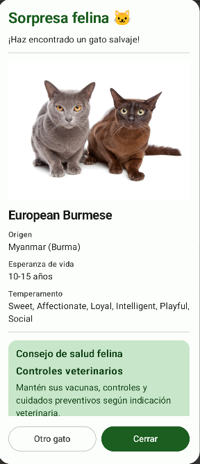

# Kaiju Inventario

Aplicación Android de **control de inventario** para el caso **Kaiju**: catálogo de productos, registro de movimientos (entrada, salida y ajuste), trazabilidad y alertas de stock bajo.

- Asignatura: **DSY1105 · Desarrollo de Aplicaciones Móviles** · Duoc UC · 2026-2
- Base: Guía 10 · *Proyecto Kaiju: base del proyecto y avance*
- Stack: Kotlin · Jetpack Compose · Material3 · MVVM

## Equipo

|---|

Vicente Markov
José Miguel Ibarra

|---|

vi.markov@duocuc.cl

jo.ibarrav@duocuc.cl

## Descripción de la app

La app permite iniciar sesión con un usuario de prueba (administrador, vendedor o encargado de inventario) y muestra solo las opciones que le corresponden a ese perfil.

- **Catálogo**: lista de productos con buscador por nombre o código, filtro por categoría y marca de stock bajo.
- **Detalle de producto**: datos del producto e historial de movimientos, del más reciente al más antiguo.
- **Formulario de producto** (solo administrador): crear o editar productos con validación campo a campo.
- **Movimiento**: registro de entradas, salidas (venta o consumo) y ajustes de inventario *(formulario completo en la próxima revisión)*.
- **Alertas**: productos con stock igual o menor al stock mínimo; al tocar uno se abre su detalle.

## Estructura

Organización por capas (Guía 10, sección 3), bajo `app/src/main/java/com/example/kaiju/`:

```
MainActivity.kt          // solo llama a AppNavHost()
navigation/              // rutas (sealed) y NavHost con menú inferior
model/                   // Producto, Movimiento, Usuario, estados de formularios
repository/              // InventarioRepository (en memoria) y DatosDePrueba
viewmodel/               // SesionViewModel e InventarioViewModel (reglas RN)
ui/screen/               // las 6 pantallas
ui/components/           // TarjetaProducto e IndicadorStock
ui/theme/                // colores y tipografía
```

Las pantallas solo muestran estado; la validación y las reglas de negocio viven en el `InventarioViewModel`; el `InventarioRepository` es el único que guarda los datos (hoy en memoria; más tarde persistencia local, sin tocar las pantallas).

## Decisiones del equipo (sección 6 de la Guía 10)

Cada decisión debe justificarse con la necesidad del caso.

| Decisión | Decisión tomada | Justificación |
|---|---|---|
| Dos recursos nativos | *Pendiente* | *Pendiente* |
| Animaciones | *Pendiente* | *Pendiente* |
| Un módulo propio | *Pendiente* | *Pendiente* |
| Identidad visual | Paleta **verde bosque + ámbar** en `ui/theme/` (`Color.kt`, esquemas claro y oscuro completos, color dinámico desactivado), tipografía con títulos en negrita (`Type.kt`), formas redondeadas (`Shapes.kt`) y la mascota de `iconokaiju.png` como ícono de launcher e imagen de marca en el login | Verde = inventario saludable; ámbar = acento de alertas/reposición; rojo solo para stock crítico. Paleta fija (no Material You) para que la app tenga la misma identidad en cualquier dispositivo. El ícono se genera adaptativo (API 26+) con fondo verde `#C8E6C9` y PNG legacy para API 24-25, todo desde `iconokaiju.png` |

## Cómo compilar y probar

```powershell
cd Kaiju
.\gradlew.bat assembleDebug     # genera el APK de debug
.\gradlew.bat installDebug      # instala en el emulador/dispositivo conectado
```

## Easter Egg – Integración con The Cat API.

### Descripción

KaijuApp incorpora una funcionalidad oculta para demostrar el consumo de una API REST externa mediante Retrofit, Kotlin y Jetpack Compose.

Al presionar **10 veces el botón Catálogo** del menú inferior, aparece una ventana que muestra:

- Una imagen aleatoria de un gato.
- Información de su raza, origen, temperamento y esperanza de vida.
- Un consejo local de salud felina.
- La opción **Otro gato**, que permite solicitar una nueva fotografía.
- La opción **Cerrar**, que permite regresar al catálogo.

### API utilizada

**Nombre:** The Cat API

**Sitio web:** https://thecatapi.com/

**Endpoint principal:**

`GET https://api.thecatapi.com/v1/images/search?limit=1&has_breeds=1&include_breeds=1`

La solicitud utiliza la cabecera `x-api-key` y obtiene una respuesta JSON con fotografías y metadatos de razas.

### Tecnologías y arquitectura

La implementación sigue el patrón MVVM:

| Capa | Archivo | Responsabilidad |
|---|---|---|
| Model | `GatoResponse.kt` | Representa la respuesta JSON de la API. |
| Model | `GatoApi.kt` | Representa los datos utilizados por la interfaz. |
| Model | `EasterEggEstado.kt` | Define los estados de carga, resultado y error. |
| Repository | `CatApiService.kt` | Define los endpoints mediante anotaciones Retrofit. |
| Repository | `CatRepository.kt` | Realiza solicitudes y transforma respuestas. |
| ViewModel | `EasterEggViewModel.kt` | Controla las diez pulsaciones, solicitudes y estados. |
| UI | `DialogoEasterEgg.kt` | Muestra fotografías, información y consejos de salud. |
| Navigation | `AppNavHost.kt` | Detecta la combinación que activa el Easter Egg. |

Se utiliza **Retrofit y Gson** para las respuestas HTTP y JSON, **Kotlin Coroutines** para las operaciones asíncronas, **StateFlow** para el estado observable y **Coil 3** para cargar imágenes.

### Configuración

1. Obtener una API key desde https://thecatapi.com/.
2. Crear o abrir `local.properties` en la raíz del proyecto.
3. Agregar la propiedad `CAT_API_KEY=TU_CLAVE_PERSONAL`.
4. Sincronizar Gradle.
5. Ejecutar KaijuApp en Android Studio.

`local.properties` está excluido del control de versiones y no debe subirse a GitHub.

La API key se incorpora en `BuildConfig` durante la compilación. Esta solución evita publicar la credencial en el código fuente, aunque no impide extraerla de un APK distribuido.

### Cómo acceder

1. Iniciar sesión con un usuario de prueba.
2. Abrir la pantalla Catálogo.
3. Presionar diez veces el botón **Catálogo** del menú inferior.
4. Esperar la respuesta de The Cat API.
5. Utilizar **Otro gato** para consultar otra fotografía.

El ViewModel evita solicitudes repetidas durante recomposiciones y conserva temporalmente la última respuesta para reutilizarla cuando corresponda.

### Pruebas

Se implementaron pruebas unitarias en `CatRepositoryTest.kt` para comprobar:

| Prueba | Comportamiento esperado |
|---|---|
| `idVacioEsRechazado` | Rechaza un identificador vacío. |
| `consultaExitosaDevuelveGato` | Convierte una respuesta simulada HTTP 200 en un modelo `GatoApi`. |
| `falloConexionEsPropagado` | Propaga una excepción de conexión. |
| `respuestaVaciaEsRechazada` | Rechaza una respuesta sin imágenes. |

Comando para ejecutar las pruebas:

```powershell
.\gradlew.bat :app:testDebugUnitTest --tests "com.example.kaiju.CatRepositoryTest"
```

Además de estas pruebas automatizadas, se debe comprobar manualmente que el diálogo muestre una fotografía real, presente los errores de conexión y permita reintentar después de recuperar internet.

### Evidencia visual



### Consideraciones

- Requiere conexión a internet para descargar nuevas fotografías.
- Los consejos de salud felina están almacenados localmente.
- La funcionalidad no modifica los productos ni movimientos de inventario.
- Las fallas de red se manejan sin cerrar inesperadamente la aplicación.
- La clave de API no se publica en el repositorio.

## Datos

Todos los productos, usuarios y movimientos son **ficticios** (el caso prohíbe usar datos reales de Kaiju o de personas). Viven en `repository/DatosDePrueba.kt`.
